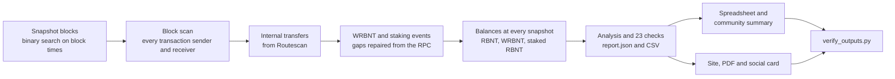

<p align="center">
  <picture>
    <source media="(prefers-color-scheme: dark)" srcset="public/assets/img/redbelly-holder-on-dark.svg">
    
  </picture>
</p>

<h1 align="center">RBNT Quarterly On-Chain Holder Report</h1>

<p align="center">
  A sourced, repeatable report on how RBNT holders behave on Redbelly mainnet:<br>
  accumulation, selling, staking and how concentrated holdings are.
</p>

<p align="center">
  <a href="https://redbelly-holder.vercel.app"></a>
  
  
  
  
</p>

<p align="center">
  <a href="https://redbelly-holder.vercel.app"><b>Read the report</b></a> &nbsp;|&nbsp;
  <a href="public/downloads/redbelly-holder.pdf"><b>PDF</b></a> &nbsp;|&nbsp;
  <a href="COMMUNITY_SUMMARY.md"><b>Community summary</b></a> &nbsp;|&nbsp;
  <a href="public/data/"><b>Data</b></a> &nbsp;|&nbsp;
  <a href="METHOD.md"><b>Method</b></a>
</p>

---

## Contents

- [Overview](#overview)
- [Q3 2026 at a glance](#q3-2026-at-a-glance)
- [Deliverables](#deliverables)
- [How it works](#how-it-works)
- [Data sources](#data-sources)
- [Verification](#verification)
- [Naming policy](#naming-policy)
- [Producing the next edition](#producing-the-next-edition)
- [Repository structure](#repository-structure)
- [Deployment](#deployment)
- [Design and accessibility](#design-and-accessibility)
- [Known limits](#known-limits)
- [Disclaimer](#disclaimer)

## Overview

Holders keep asking what the large wallets are doing, and the answers are often screenshots and guesses. This report replaces that with a calm, factual picture taken straight from the chain.

The first edition covers **Q3 2026, from 1 July 00:00 UTC to 30 September 23:59:59 UTC**. Every balance is read from the Redbelly RPC at four fixed blocks (start of quarter, end of July, end of August, end of quarter), every figure can be traced to those blocks, and the whole pipeline can be rerun for the next quarter by changing one setting.

The report is about trends, not people. Only wallets that are already public are named. Every other address appears only inside group totals.

## Q3 2026 at a glance

| Measure | 1 July 2026 | 30 September 2026 | Change |
|---|---:|---:|---:|
| Holders with at least 1 RBNT | 53,567 | 53,727 | +0.3% |
| RBNT staked in the two Reddex pools | 635.8 million | 751.3 million | +18.2% |
| Wallets with a stake | 1,268 | 1,255 | -13 |
| Share held by the largest 10 holders (outside named wallets) | 60.7% | 59.1% | -1.6 points |
| Same, counting regular wallets only | 47.5% | 48.4% | +1.0 points |
| RBNT in the nine reserved wallets | 5.97 billion | 5.93 billion | -0.7% |
| WRBNT supply | 1.82 billion | 1.74 billion | -4.5% |

Further detail from the report:

- Of the 10 largest holders on 1 July, 6 reduced their holdings by more than 1% and 1 added. Ranks 11 to 100 went the other way: 41 added and 12 reduced.
- 786.4 million RBNT moved between the reserved wallets themselves. 43.8 million left the group, all from Ecosystem (Unlocked), including 15 million of staking reward funding.
- 1,999,924 RBNT was paid in network fees during the quarter. Redbelly pays these fees back out to network participants instead of burning them, so total supply held steady.

A drop in holdings is reported as "reduced", not "sold": the chain shows that RBNT moved, not why.

## Deliverables

| Deliverable | Location |
|---|---|
| Report website with animated charts | [redbelly-holder.vercel.app](https://redbelly-holder.vercel.app), source in [`public/index.html`](public/index.html) |
| Report as PDF (A4, with charts and tables) | [`public/downloads/redbelly-holder.pdf`](public/downloads/redbelly-holder.pdf) |
| Community summary (X thread and short version) | [`COMMUNITY_SUMMARY.md`](COMMUNITY_SUMMARY.md) |
| Data behind every chart (spreadsheet) | [`public/data/RBNT-Holder-Report-Q3-2026-data.xlsx`](public/data/RBNT-Holder-Report-Q3-2026-data.xlsx) |
| Data behind every chart (CSV, also zipped) | [`public/data/`](public/data/) |
| All figures in one machine readable file | [`public/data/report.json`](public/data/report.json) |
| Method and sources | [`METHOD.md`](METHOD.md) |

## How it works



1. **Snapshot blocks.** The last block at or before each cut-off second, found on the RPC and matched against Routescan.
2. **Every address that could hold RBNT.** A full scan of all 3.2 million blocks, plus contracts created, internal transfers, WRBNT and staking events, block header validator addresses and Routescan's holder list. In this edition: 745,579 addresses.
3. **Balances from the chain.** RBNT, WRBNT and staked RBNT for every address at every snapshot block, read with `eth_getBalance` and `eth_call`.
4. **Each RBNT counted once.** WRBNT and staked RBNT are credited to the address that owns them. The WRBNT contract and the pools keep only what is not owed to anyone, such as staking reward funds.
5. **Groups, not individuals.** Holders are grouped by balance band and by rank at the start of the quarter.

The full definitions are in [METHOD.md](METHOD.md).

## Data sources

| Source | Used for |
|---|---|
| Redbelly mainnet RPC, chain ID 151 (`governors.mainnet.redbelly.network`) | Every balance and contract read, blocks, transactions, receipts, contract code |
| [Routescan](https://redbelly.routescan.io) Etherscan-compatible API | Internal transfers, event logs, block by time, verified contract source |
| Routescan explorer pages | Public name tags for exchanges and contracts |
| [DAO treasury page](https://redbellydao.network/treasury/) | Names, addresses and original allocations of the nine reserved wallets |
| [Redbelly fee distribution](https://vine.redbelly.network/network-fees/distribution/) | How network fees are shared out |

Balances always come from the RPC. Explorer balances are not used, because Routescan's holder list showed stale balances for about 2,200 addresses.

## Verification

Every rebuild runs 23 checks. Publishing stops if any of them fails. All 23 passed for this edition.

| Check | What it proves |
|---|---|
| Snapshot blocks match Routescan | The four blocks describe the intended moments |
| All balances add up to the 10 billion RBNT at launch (to within 0.001%) | No meaningful holder is missing from the address list |
| Total supply held steady through the quarter | Fees were paid back out, not burned |
| WRBNT balances equal WRBNT supply, and wraps minus unwraps equal supply | No WRBNT holder or event is missing |
| Staker positions and stake events equal each pool's `totalStake()` | No staker or staking event is missing |
| The holdings view still adds up to total supply | Wrapped and staked RBNT are counted exactly once |
| Each reserved wallet's transfers and fees explain its balance change to the last RBNT | Named wallet flows are complete |

[`scripts/verify_outputs.py`](scripts/verify_outputs.py) then checks every published file: no unlabelled address, no em or en dashes and no emoji (brand rules), no price language, and every figure in the community summary traced back to `report.json`.

## Naming policy

- **Named:** the nine reserved wallets from the DAO treasury page, the Wrapped RBNT contract, the two Reddex RBNT staking pools, and any exchange or contract with a public Routescan name tag.
- **Grouped:** every other address, described only by type (regular wallet or smart contract) and size group. Counterparties of named wallets are shown as "Other addresses, not named", without counts.
- **Never done:** identifying, guessing or hinting at the owner of an unlabelled address. User-chosen explorer names are ignored.

On 27 October 2026 none of the 30 largest holders outside the named wallets carried a public name tag on Routescan, so no exchange wallet is named in this edition.

## Producing the next edition

Requirements: Python 3.10+ and Node 18+ with Playwright and Chromium (for the PDF).

```bash
pip install -r scripts/requirements.txt

# 1. Set QUARTER (id, label, start and end in UTC) in scripts/common.py
cd scripts
python3 step1_snapshot_blocks.py      # snapshot blocks
python3 step2_scan_blocks.py          # full block scan, cached and resumable
python3 step3_internal_transfers.py   # internal transfers from Routescan
python3 step4_contract_logs.py        # WRBNT and staking events, with gap repair
python3 step5_balances.py             # balances at every snapshot, cached per address
python3 step6_analyse.py              # figures, CSV files and all verification checks
python3 step7_write_docs.py           # spreadsheet, CSV bundle, community summary
node step8_build_pdf.js               # PDF and social card, printed from the site
python3 verify_outputs.py             # final check of every published file
```

Before step 6, open the Routescan pages of the largest holders and record any new exchange or contract name tags in `ROUTESCAN_LABELS` in `scripts/common.py`. Keep `WORKERS` at 12 or below, because the public RPC rate limits heavy use. A full first run takes about 1.5 to 2 hours; reruns reuse the caches in `data/raw/`.

## Repository structure

```
.
|-- public/                     static site served by Vercel
|   |-- index.html              the report
|   |-- og.html                 source of the social card
|   |-- assets/                 CSS, JavaScript charts, SVG logo and favicon
|   |-- data/                   report.json, CSV files, spreadsheet, CSV bundle
|   `-- downloads/              PDF, community summary, method
|-- scripts/                    data pipeline, steps 1 to 8, plus verify_outputs.py
|-- data/raw/                   per-address caches (git ignored, rebuilt by the scripts)
|-- METHOD.md                   method, definitions, sources and known limits
|-- COMMUNITY_SUMMARY.md        X thread and short summary
`-- vercel.json                 static hosting config
```

Per-address data never leaves `data/raw/`, so no unlabelled address is ever committed or published.

## Deployment

The site is plain static files with no build step.

1. Import this repository in Vercel.
2. Leave **Root Directory** empty (the repository root). `vercel.json` sets `public/` as the output directory.
3. Deploy. Every push to `main` redeploys automatically.

If the site shows a 404, check that Root Directory is not set to `scripts` or another subfolder. Any other static host works by serving the `public/` folder.

## Design and accessibility

- Built on the Redbelly DAO Task Board brand kit (Kinetic Consensus): slate surfaces, one red accent, Be Vietnam Pro for text and JetBrains Mono for machine values.
- The logo and favicon are transparent SVGs: the Redbelly DAO mark traced from the brand kit masters, with the wordmark set in Be Vietnam Pro Bold. The favicon switches to light ink on dark browser themes.
- Charts are hand-built SVG with animated entry, hover and keyboard tooltips, and a table view for every chart.
- Light and dark themes, a 16 px minimum body size on mobile, and all motion turned off for readers who prefer reduced motion.
- The PDF is printed from the same page, so the web and PDF editions never disagree.

## Known limits

- 36,841 RBNT (0.0004% of supply) could not be placed, most likely at addresses the protocol paid directly that never appear in a transaction.
- On-chain data cannot tell a sale from a move between wallets of the same owner, or from a deposit to an unlabelled exchange wallet.
- WRBNT inside trading pools stays with the pool contract and is not split between liquidity providers.
- Holder counts count addresses, not people.

See [METHOD.md, section 10](METHOD.md#10-known-limits) for details.

## Disclaimer

This report describes past on-chain activity on Redbelly mainnet. It does not predict prices and is not financial advice or a recommendation to buy or sell.
